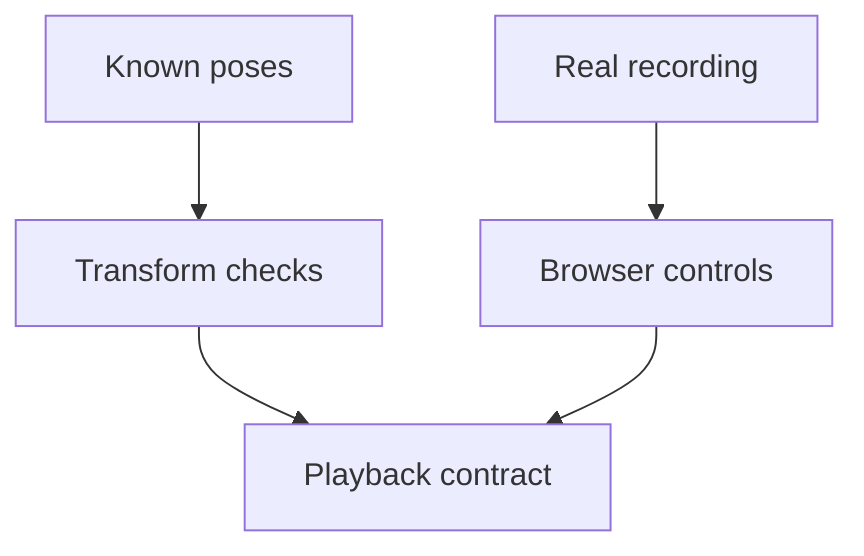

# Recorded simulation tests

These checks distinguish recorded solver poses from interpolated presentation.

| File | Evidence |
| --- | --- |
| [browser.mjs](browser.mjs) | Real 3D transforms, controls, mobile/wide layouts, both themes and disposal. |
| [replay.test.mjs](replay.test.mjs) | Invalid inputs, analytic rotations, time boundaries and clock disposal. |
| [scenarios-browser.mjs](scenarios-browser.mjs) | Scenario switch of a replay index against an independent pose oracle with a planted control, summary text, the followed camera, autoplay and loop, and a tampered recording refused. |

[Webkit tests](../README.md)
