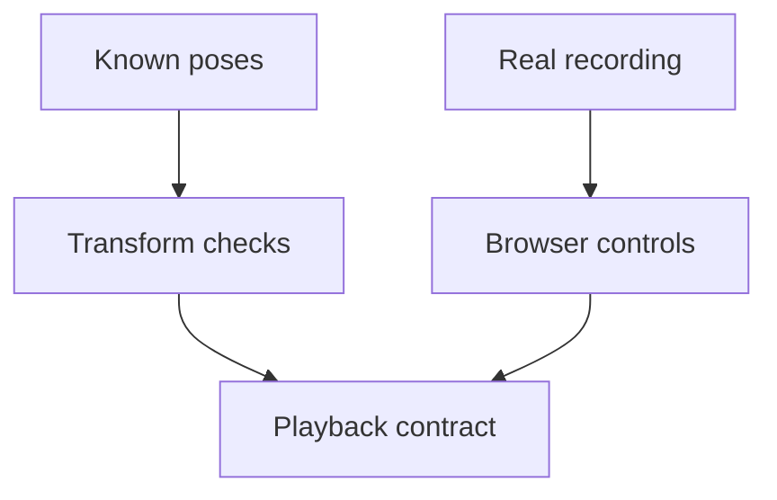

# Recorded simulation tests

These checks distinguish recorded solver poses from interpolated presentation.

| File | Evidence |
| --- | --- |
| [browser.mjs](browser.mjs) | Real 3D transforms, controls, mobile/wide layouts, both themes and disposal. |
| [replay.test.mjs](replay.test.mjs) | Invalid inputs, analytic rotations, time boundaries and clock disposal. |

[Webkit tests](../README.md)
