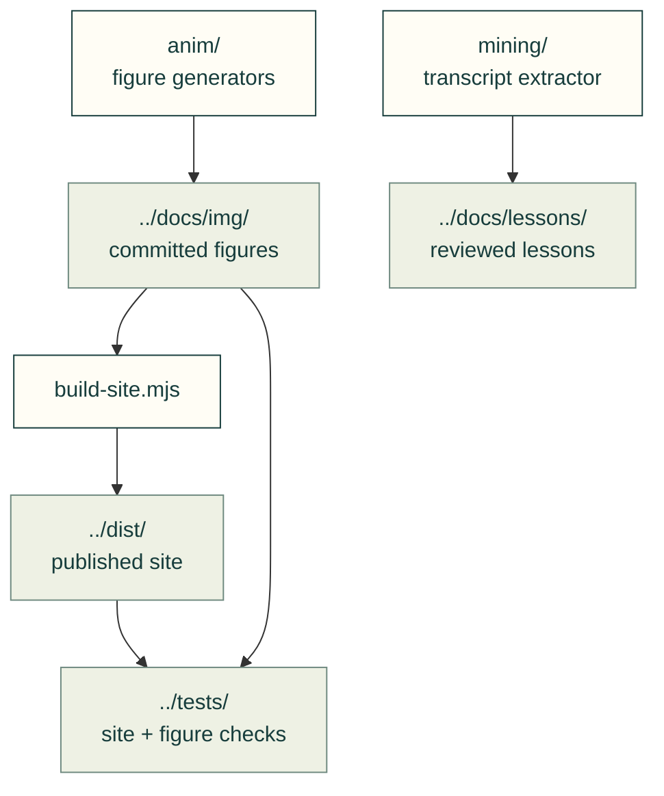

# Repository tools

Build the site, generate figures, maintain releases and audit the toolkit. Engineering code lives in [src/cadagent](../src/cadagent/README.md).

The arrows show the artifacts these tools produce and the checks that consume them.

| Work | Entry point |
|---|---|
| Source selection and stable public paths | [site/](site/README.md) |
| Site build and preview | [build-site.mjs](build-site.mjs), [preview-site.mjs](preview-site.mjs), [pages-build.mjs](pages-build.mjs); `npm run build:site` |
| Catalogue and references | [site-catalog.mjs](site-catalog.mjs), [site-references.mjs](site-references.mjs), [reference importer](import_refmap.py) |
| Animated figures | [anim/](anim/), [readme_anim.py](readme_anim.py), [motion_figures.py](motion_figures.py); generators support `--check` |
| Transcript mining | [mining/](mining/README.md); private transcripts → reviewed, sourced lessons |
| Supply-chain maintenance | [resource_audit.py](resource_audit.py), [vendor_sync.py](vendor_sync.py), [weekly procedure](../docs/practice/weekly-upstream-update.md) |
| Release and review gates | [cut_release.py](cut_release.py), [ci_gates.py](ci_gates.py); [contributor workflow](../.github/CONTRIBUTING.md) |
| Quickstart evaluation | [quickstart_eval.py](quickstart_eval.py); grades transcript/file evidence, not physical quality |

Run commands from the repository root. Long builds and test suites use the maintainer compute workflow; generators state their inputs and limits in their docstrings. [Repository](../README.md) · [Guides](../docs/README.md) · [Tests](../tests/README.md)
