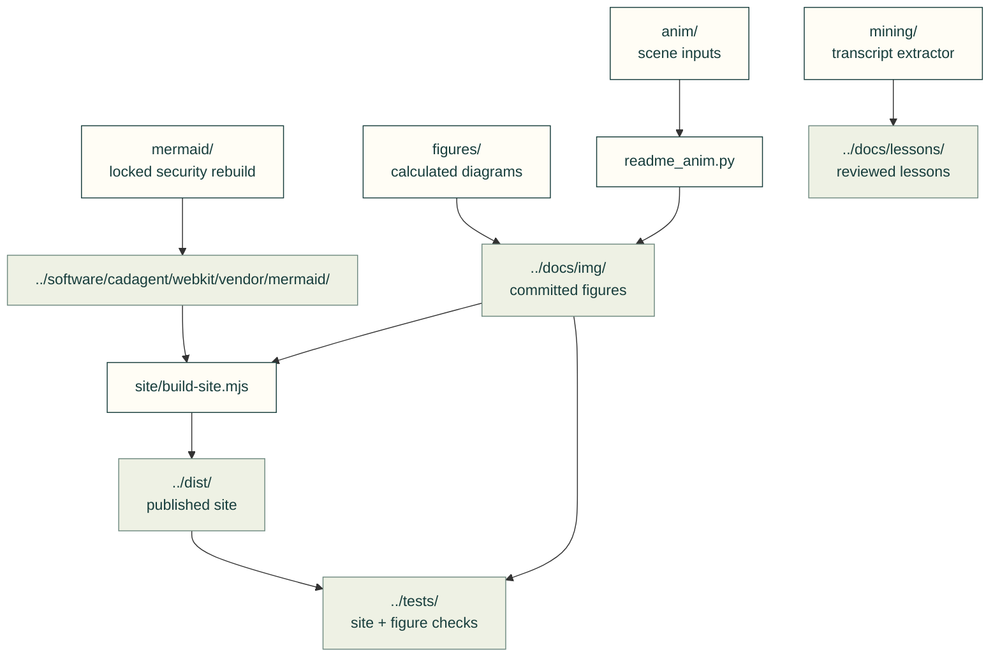

# Repository tools

Build the site, generate figures, maintain releases and audit the toolkit. Engineering code lives in [software/cadagent](../software/cadagent/README.md).

The arrows show the artifacts these tools produce and the checks that consume them.

| Work | Entry point |
|---|---|
| Source selection and stable public paths | [site/](site/README.md) |
| Site build and preview | [build-site.mjs](site/build-site.mjs), [preview-site.mjs](site/preview-site.mjs), [pages-build.mjs](site/pages-build.mjs); `npm --prefix tools/site run build:site` |
| Catalogue and references | [site-catalog.mjs](site/compiler/site-catalog.mjs), [site-references.mjs](site/compiler/site-references.mjs), [reference importer](import_refmap.py) |
| Calculated diagrams | [figures/](figures/README.md): bearings, inserts, linkages, motion, printed joints, snaps and process rules |
| Animated scenes | [anim/](anim/), [readme_anim.py](readme_anim.py); regenerate or use `--check` |
| Transcript mining | [mining/](mining/README.md); private transcripts → reviewed, sourced lessons |
| Supply-chain maintenance | [resource_audit.py](resource_audit.py), [vendor_sync.py](vendor_sync.py), [weekly procedure](../docs/practice/weekly-upstream-update.md) |
| Fixed-dependency Mermaid rebuild | [mermaid/](mermaid/README.md): isolated maintainer dependencies, derived browser bytes, input provenance and notices |
| Release and review gates | [cut_release.py](cut_release.py), [ci_gates.py](ci_gates.py); [contributor workflow](../.github/CONTRIBUTING.md) |
| Quickstart evaluation | [quickstart_eval.py](quickstart_eval.py); grades transcript/file evidence, not physical quality |

Run commands from the repository root. Long builds and test suites use the maintainer compute workflow; generators state their inputs and limits in their docstrings. [Repository](../README.md) · [Guides](../docs/README.md) · [Tests](../tests/README.md)

The homepage Gyropup model is regenerated from its current CAD collector, not old STEP exports. Run
`gyropup_showcase.py --only model --gyropup <clean-checkout> --toolkit <pinned-toolkit> --output <fresh-directory>`
on the compute fleet using the product's recorded CAD runtime. Review the recorded inputs, included/omitted members
and source/output hashes, then run `node tools/site/figures/site-model-poster.mjs` for the matching poster and project
card. Model updates leave historical FEA pictures and their evidence untouched.

## File and child ownership

| File or folder | Purpose |
|---|---|
| [cfd_fan_figure.py](cfd_fan_figure.py) | Draw recorded fan/CFD study data. |
| [explore_charts.py](explore_charts.py) | Draw exploration comparison charts. |
| [fea_layer_figure.py](fea_layer_figure.py) | Draw layered-material study evidence. |
| [fea_mesh_figure.py](fea_mesh_figure.py) | Draw mesh-convergence study evidence. |
| [formula_vectors.py](formula_vectors.py) | Generate shared formula parity fixtures. |
| [gate_timing.py](gate_timing.py) | Measure existing gate execution timings. |
| [gyropup_showcase.py](gyropup_showcase.py) | Collect pinned product showcase artifacts. |
| [insert_coupons.py](insert_coupons.py) | Generate insert fit coupon artifacts. |
| [plates_figure.py](plates_figure.py) | Draw plate model evidence. |
| [references_health_apply.py](references_health_apply.py) | Apply reviewed source-health metadata updates. |
| [research_figures.py](research_figures.py) | Draw source-bound research survey figures. |
| [security_scan.py](security_scan.py) | Repository security scanning entry point. |
| [volume_probe.py](volume_probe.py) | Record geometric volume precision evidence. |
