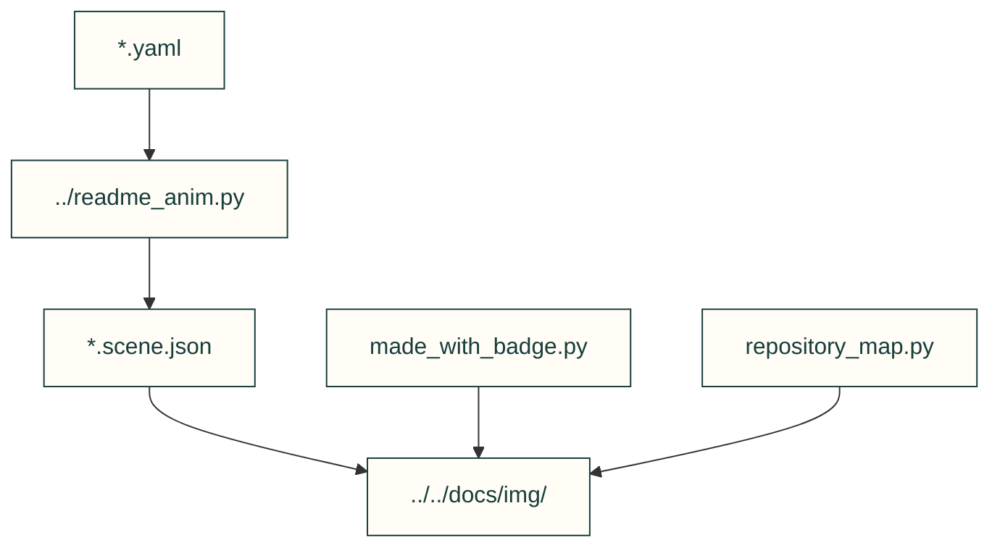

# Animation scene inputs

Recorded scene inputs and original artwork producers used by the existing README animation tools. Decorative art is distinct from engineering evidence.

| File or folder | Purpose |
|---|---|
| [fea-convergence.yaml](fea-convergence.yaml) | Real-run extraction configuration for the mesh study. |
| [fea-convergence.scene.json](fea-convergence.scene.json) | Recorded mesh-study drawing input. |
| [gyropup-leg.yaml](gyropup-leg.yaml) | Pinned product CAD scene extraction configuration. |
| [gyropup-leg.scene.json](gyropup-leg.scene.json) | Recorded leg drawing input; not the current homepage model. |
| [snap-engagement.yaml](snap-engagement.yaml) | Calculator-derived snap scene configuration. |
| [snap-engagement.scene.json](snap-engagement.scene.json) | Recorded snap engagement drawing input. |
| [made_with_badge.py](made_with_badge.py) | Original vector badge around the project emblem. |
| [repository_map.py](repository_map.py) | Original decorative robot-factory cinematic. |

[Parent map](../README.md)
