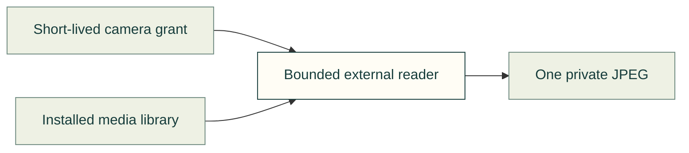

# One private camera frame

This optional **external program is under development** to read one P1S JPEG through the owner's already installed Bambu media library. It is AGPL-3.0-only and is not imported by, linked into or included in the cad-agent Python package. No proprietary binary is distributed.

The camera integration is work in progress. The parent checks the reader's source digest and executes a private copy of those verified bytes, so replacing the original path cannot substitute a program that receives the grant. A frame does not establish an empty bed or authorize a print. X1E video is not supported by this reader.

| File | Purpose |
|---|---|
| [capture.py](capture.py) | Standalone native-library reader; private input arrives on stdin. |
| [COPYING](COPYING) | GNU Affero General Public License version 3. |

The ABI declarations are adapted from [Bambu Studio's public BambuTunnel.h](https://github.com/bambulab/BambuStudio/blob/355d71eee5a9ebc794693fe57e63674806019770/src/slic3r/GUI/Printer/BambuTunnel.h), under that repository's AGPL-3.0 license. Only the video-read interface is used. The official networking SDK, application identities and signing keys are not used.

[Repository tools](../README.md) · [Bambu integration](../../software/cadagent/manufacturing/devices/bambu/README.md)
