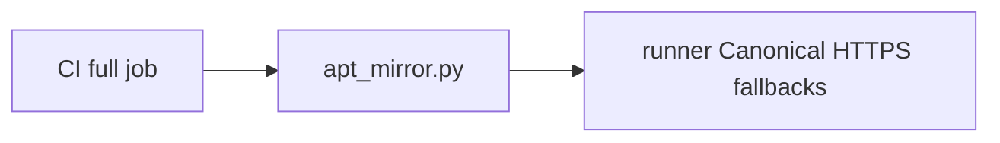

# CI provisioning tools

Small runner provisioning corrections live here as the tools root reaches its growth limit.
The release and review entry points remain in the parent directory.

| File | Purpose |
| --- | --- |
| [apt_mirror.py](apt_mirror.py) | Remove the exact stalled Azure HTTP mirror entry while retaining existing Canonical HTTPS sources and apt signature checks. |

[Tools](../README.md)
