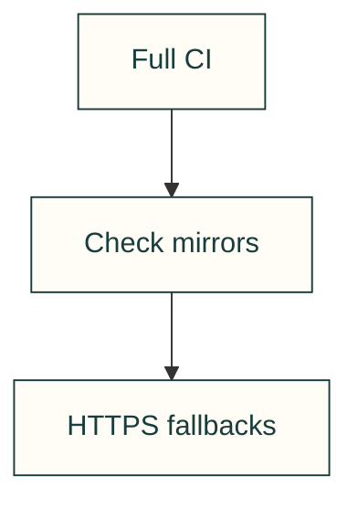

# CI provisioning tools

Small runner provisioning corrections live here as the tools root reaches its growth limit.
The release and review entry points remain in the parent directory.

| File | Purpose |
| --- | --- |
| [apt_mirror.py](apt_mirror.py) | Prefer the registered HTTPS mirror after validating the Ubuntu 24.04/noble source profile; retain Canonical fallbacks/signature checks and report a redacted profile on rejection. |

[Tools](../README.md)
