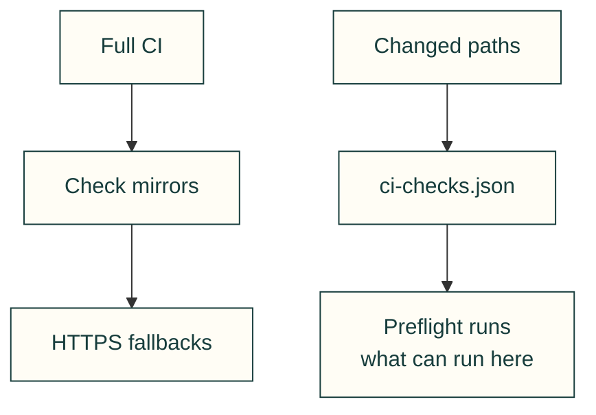

# CI provisioning tools

Small runner provisioning corrections and the local mirror of what CI checks live here, as the tools root reaches
its growth limit. The release and review entry points remain in the parent directory.

| File | Purpose |
| --- | --- |
| [apt_mirror.py](apt_mirror.py) | Prefer the registered HTTPS mirror after validating the Ubuntu 24.04/noble source profile; retain Canonical fallbacks/signature checks and report a redacted profile on rejection. |
| [preflight.py](preflight.py) | Before pushing: from `git diff origin/dev...` (or `--paths`) select the checks CI runs on those paths from [`.github/ci-checks.json`](../../.github/ci-checks.json), run what this machine can, and report the rest as `not run: <reason>` (engine, Python minor, Node deps, OS) or `skipped: slow`, listed again at the end. Exit 0 when every selected check ran and passed (verdict `passed`) or none was selected (`nothing selected`), 1 when one failed, 2 on a setup error or malformed mapping, 3 when some did not run (`incomplete`; the closing lines split skipped-as-slow from cannot-run-here), 130/143/129 on SIGINT/SIGTERM/SIGHUP (the running check's process group is stopped and the finished checks are still reported). `--only` runs a named check even if slow or unselected; `--workdir` sets where run folders go. `--list`, `--json`, `--only`, `--slow`, `--python`. Mirrors CI; does not replace it, installs nothing, uses no network. |

[Tools](../README.md)
