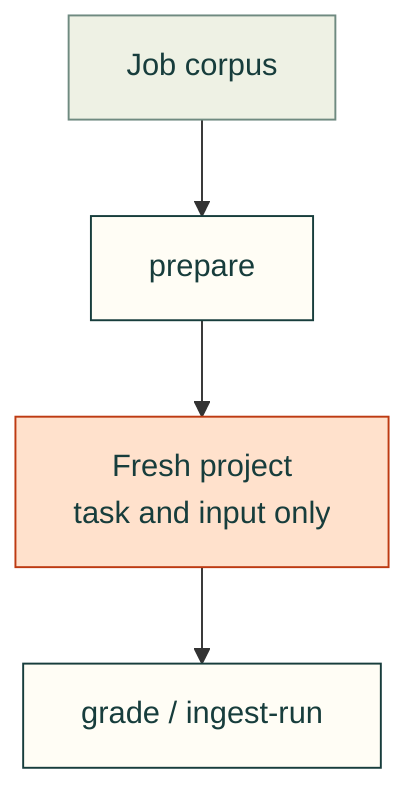

# Evaluation controllers

`standard_eval.py` prepares and grades the versioned analytical starter corpus. It does not run subject code while grading. See [design and testing](../../docs/practice/standard-evaluation.md).

Its whole-checkout kit access is legacy smoke-test behavior. New controlled CAD studies need the
[planned subject boundary and qualification tests](../../docs/practice/standard-evaluation.md#planned-cad-design-evaluations);
the optional adapter implementation is tracked in
[#647](https://github.com/Valpatel/cad-agent/issues/647). Runtime qualification is not established yet.
The implementation remains a draft: no pinned Inspect environment, sandbox image or real qualification suite
has been accepted. The metadata probe requires a separately reviewed action packet before execution; it does
not install an environment or qualify an image. Existing v1 commands remain unchanged.

## File ownership

| File | Purpose |
|---|---|
| [standard_eval.py](standard_eval.py) | Validate the corpus, prepare subject inputs, independently grade artifacts and ingest run metadata. |
| [runner.py](runner.py) | Collect fresh Codex or Claude CLI conversations; finalize outside the retained service only after its cgroup stops, then grade settled artifacts and transcript bytes. |
| [inspect_runner.py](inspect_runner.py) | Draft optional inert Inspect collector/finalizer, bounded stopped-container snapshots and loopback-provider controls; requires the full retained negative-control suite before qualification. |
| [inspect_runtime_probe.py](inspect_runtime_probe.py) | Hash-bound metadata-only setup probe with offline frozen exports; no environment installation or image operations. Execution remains subject to action review. |

[Repository tools](../README.md)
