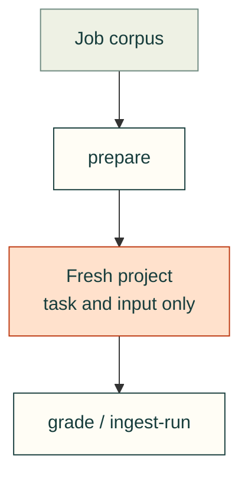

# Evaluation controllers

`standard_eval.py` prepares and grades the versioned analytical starter corpus. It does not run subject code while grading. See [design and testing](../../docs/practice/standard-evaluation.md).

Its whole-checkout kit access is legacy smoke-test behavior. New controlled CAD studies need the
[planned subject boundary and qualification tests](../../docs/practice/standard-evaluation.md#planned-cad-design-evaluations);
the optional adapter implementation is tracked in
[#647](https://github.com/Valpatel/cad-agent/issues/647). Runtime qualification is not established yet.
The implementation remains a draft: no pinned Inspect environment, sandbox image or real qualification suite
has been accepted. The metadata probe requires a separately reviewed action packet before execution; it does
not install an environment or qualify an image. Existing v1 commands remain unchanged.

Before optional runtime provisioning, run `python tools/evaluation/inspect_runner.py preflight`.
This read-only command checks Python, Linux/cgroup v2, the user service manager, the explicitly local
Docker daemon and Compose plugin. It needs no work directory or installed Inspect package; add
`--inspect-source PATH` to also check the pinned import source. Unavailable prerequisites produce
structured JSON and exit 1; omitted source checks remain `not_checked`. A running or degraded
user manager only establishes availability, never the required retained-service behavior.
`runtime_qualified` is always false. An executor with an offline user manager needs a suitable
execution host before the retained suite; direct subprocess or mocked runs cannot replace it.

Full qualification still requires the real-case driver, retained positive/negative evidence,
failed-cleanup controls and preservation of an unrelated resource. The current eight case definitions
alone do not establish all of those boundaries.

## File ownership

| File | Purpose |
|---|---|
| [standard_eval.py](standard_eval.py) | Validate the corpus, prepare subject inputs, independently grade artifacts and ingest run metadata. |
| [runner.py](runner.py) | Collect fresh Codex or Claude CLI conversations; finalize outside the retained service only after its cgroup stops, then grade settled artifacts and transcript bytes. |
| [inspect_runner.py](inspect_runner.py) | Read-only prerequisite diagnostics and draft optional inert Inspect collector/finalizer, bounded stopped-container snapshots and loopback-provider controls; requires the full retained negative-control suite before qualification. |
| [inspect_runtime_probe.py](inspect_runtime_probe.py) | Hash-bound metadata-only setup probe with offline frozen exports; no environment installation or image operations. Execution remains subject to action review. |

[Repository tools](../README.md)

The metadata probe uses its invoking Python interpreter and inherited HTTPS proxy/CA trust; it does not assume a
system Python path or bypass a managed network proxy. The Docker client is resolved before the child PATH is
narrowed. Failed commands retain their primary outcome even if an output hash or receipt write also fails.
These portability checks do not replace the required retained user-service and Docker settlement evidence.
