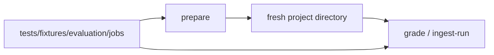

# Evaluation controllers

`standard_eval.py` prepares and grades the versioned analytical starter corpus. It does not run subject code while grading. See [design and testing](../../docs/practice/standard-evaluation.md).

