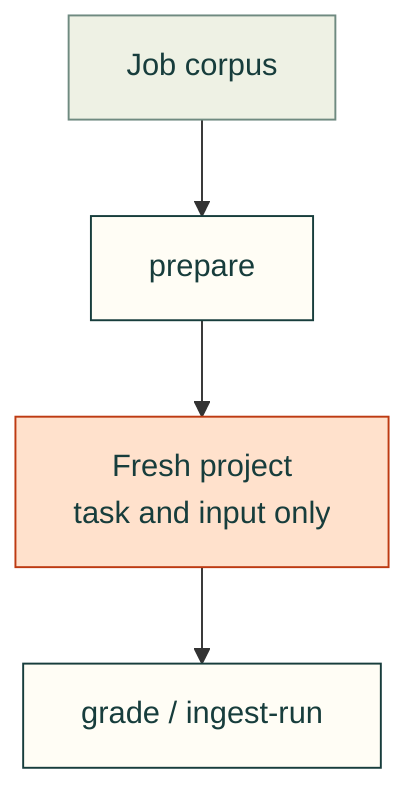

# Evaluation controllers

`standard_eval.py` prepares and grades the versioned analytical starter corpus. It does not run subject code while grading. See [design and testing](../../docs/practice/standard-evaluation.md).

## File ownership

| File | Purpose |
|---|---|
| [standard_eval.py](standard_eval.py) | Validate the corpus, prepare subject inputs, independently grade artifacts and ingest run metadata. |
| [runner.py](runner.py) | Collect fresh Codex or Claude CLI conversations; finalize outside the retained service only after its cgroup stops, then grade settled artifacts and transcript bytes. |

[Repository tools](../README.md)
