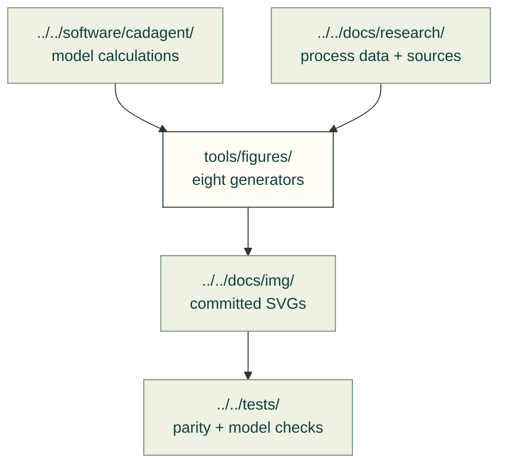

# Calculated figures

These repository scripts draw committed diagrams from the toolkit's equations, fixtures and cited process data. The figures show model results and assumptions; they do not qualify a physical part.

Run from the repository root with its dependencies available. For example, `PYTHONPATH=software python tools/figures/bearing_figures.py --check` compares the current calculation to its committed SVGs. The seven checkable generators return failure on stale figures; omit `--check` to regenerate them. `snapfit_figures.py` only regenerates its two guide figures and needs `PYTHONPATH=software` or an installed toolkit.

| Script | Output under docs/img/ | Existing checks |
|---|---|---|
| [bearing_figures.py](bearing_figures.py) | bearings: life, ratings and example margins | [bearing tests](../../tests/formulas/test_bearings.py) |
| [insert_figures.py](insert_figures.py) | inserts: clamp paths, capacity and fixes | [insert figures](../../tests/mechanical/test_insert_figures.py) |
| [linkage_figures.py](linkage_figures.py) | linkages: five-bar stride and workspace | [linkages](../../tests/mechanical/test_linkages.py) |
| [motion_figures.py](motion_figures.py) | motion: gate and geometry fixtures | [motion figures](../../tests/mechanical/test_motion_figures.py) |
| [printed_joint_figures.py](printed_joint_figures.py) | joints: eye, peel and coupon examples | [printed joints](../../tests/mechanical/test_printed_joints.py) |
| [snapfit_figures.py](snapfit_figures.py) | compliant: the guide's two cantilever examples | [snap-fit and generator checks](../../tests/mechanical/test_snapfit.py) |
| [process_figures.py](process_figures.py) | process: walls, layers, bends and hardware prices | [process figures](../../tests/manufacturing/test_process_figures.py) |
| [process_profile_figures.py](process_profile_figures.py) | research and sheet-metal: cited rule charts | [process profiles](../../tests/manufacturing/test_process_profiles.py) |

[Repository tools](../README.md) · [Animated scene inputs](../anim/) · [Site figure tools](../site/figures/README.md)
