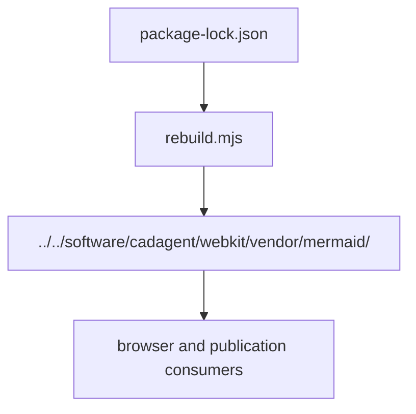

# Mermaid security rebuild

This maintainer-only build context wraps Mermaid 11's official npm core entry with fixed, exactly locked sanitizer
and math dependencies. It preserves the existing `globalThis.mermaid` browser API. Production website installation
still uses only `tools/site`; it does not install this compiler or execute an esbuild install hook.

Rebuild and consume the pinned runtime



Using existing Node 22, install this dedicated context and verify the committed generated files:

```bash
npm --prefix tools/mermaid ci --ignore-scripts
npm --prefix tools/mermaid run check
```

For a reviewed dependency update, use `npm --prefix tools/mermaid run rebuild`, inspect every generated delta,
run the online supply-chain rows and browser suites, and obtain independent review. Do not hand-edit the minified
bundle, library version strings, generated input record or notices. Keep lifecycle scripts disabled: esbuild uses
its exact optional platform binary, whose hash the producer checks before execution. Missing dependencies or a
wrong binary are errors, not permission to run a fallback download/install hook.

The lock carries npm archive integrity for every dependency. Start from `npm ci --ignore-scripts`; the producer
checks package owners/versions against that lock and records hashes of every emitted source input, the compiler
map, itself and the lock in `BUILD.json`. `THIRD-PARTY-LICENSES.txt` retains each emitted package's licence text,
including fastdom's licence section from its archived README. `SOURCE.json` identifies the original npm bundle
and records the derived file explicitly as patched. `--check` compares real regenerated bytes; it does not rewrite
expectations. The existing supply-chain audit checks this explicit second context, including its separate npm audit.

The first comparison rejected stock Mermaid 12.3's extra ELK/layout/licensing/size changes. Its bundled KaTeX 0.18.11
also has a registry deprecation for accidental breaking changes. This build instead pins non-deprecated 0.18.10,
above the advisory fix floor 0.18.2, and DOMPurify 3.4.17. Version declarations alone do not establish compatibility:
normal math, hostile labels, the real diagram corpus, both browser engines and release/publication evidence remain
required. The initial byte-repeat study covers Linux x64/Node 22.23.4; other build platforms are not qualified by it.

On 2026-11-07, an inert old/new control reproduced the attached-shadow template gap in DOMPurify 3.4.12 and inherited
trust in KaTeX 0.16.47; the exact emitted fixed inputs rejected both. No template or unsafe HTML was evaluated or
inserted. Eight actual consumer math renders passed at 390/1366 px in both themes ([independent scoped evidence](https://github.com/Valpatel/cad-agent/issues/322#issuecomment-6705636541)).
The existing diagram browser harness now retains those fixed-input guards and real consumer math checks; they do
not establish exploitability of the old libraries through every host configuration.

[Tool map](../README.md) · [Supply-chain procedure](../../docs/practice/supply-chain.md)

## File and child ownership

| File or folder | Purpose |
|---|---|
| [package.json](package.json) | Exact isolated producer dependencies. |
| [package-lock.json](package-lock.json) | Resolved integrity-bound producer inputs. |
| [rebuild.mjs](rebuild.mjs) | Reproduce derived renderer and provenance/notices. |
