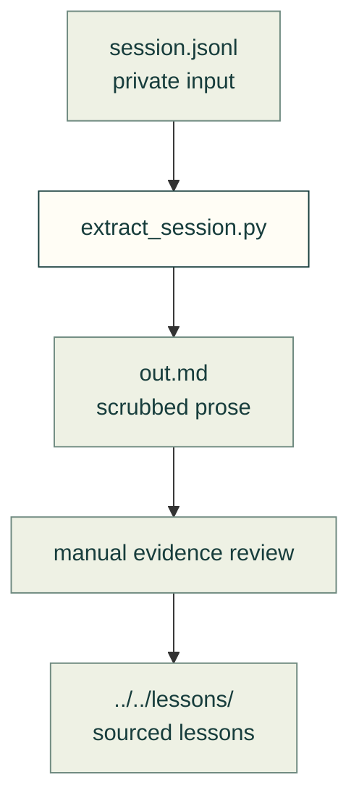

# Transcript mining

Condense a session into scrubbed prose before extracting reusable lessons. This is an offline maintainer tool.

The arrow names the files the extractor reads and writes.

| File | Purpose |
|---|---|
| [extract_session.py](extract_session.py) | Keep user messages and assistant prose, remove tool calls and common personal-data patterns |

From the repository root: `python tools/mining/extract_session.py session.jsonl out.md`.

Raw transcripts stay outside git. Both legacy `mining/raw/`, `mining/out/private/` and their new `tools/mining/` equivalents remain ignored so an old checkout cannot accidentally expose existing private files. Scrubbing recognises only its declared patterns; inspect the output before sharing it. Confirm a lesson against project evidence before treating it as fact.

[Tools](../README.md) · [Repository](../../README.md) · [Lesson format](../../docs/lessons/README.md#lesson-format)
