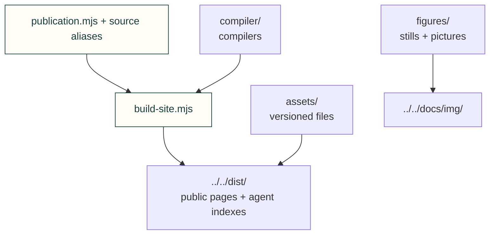

# Site tooling

Build the website from committed sources; keep actual source paths separate from public page and asset addresses.



| Owner | Purpose |
|---|---|
| [build-site.mjs](build-site.mjs) | Build HTML, Markdown twins, catalogue, references and agent indexes |
| [pages-build.mjs](pages-build.mjs) | Fetch required public history and enforce release-build validation |
| [preview-site.mjs](preview-site.mjs) | Serve the result with Pages-style routes and headers |
| [publication.mjs](publication.mjs), [page-sources.json](page-sources.json) | Dependency-free source selection and stable public page identity |
| [compiler/](compiler/README.md) | Compilers, rendering helpers and permanent redirect data |
| [figures/](figures/README.md) | Explorer stills and existing-viewer picture scripts |
| [assets/](assets/README.md) | Files emitted at /web/ and the existing installer URLs |
| package.json, package-lock.json, wrangler.toml | npm ownership, pinned dependencies and root-dist deployment configuration |

From the repository root:

```sh
npm --prefix tools/site ci
npm --prefix tools/site run build:site
npm --prefix tools/site run preview:site
```

The default result remains the repository's dist/ folder. Release builds still require a clean reviewed commit and
full history. The Pages settings transition is tracked and reviewed separately in
[#362](https://github.com/Valpatel/cad-agent/issues/362); moving these files does not change a live setting.

[Tools](../README.md) · [Site tests](../../tests/site/README.md)
