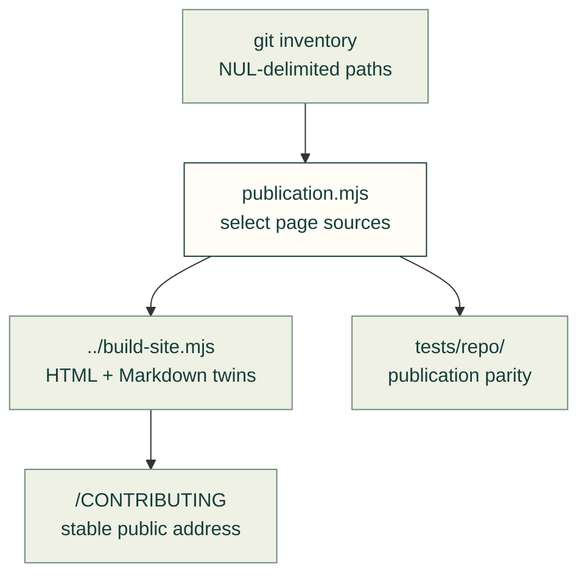

# Site publication

Choose committed page sources and preserve public page addresses when maintenance files move.

The arrows show source selection and its consumers; a public URL does not replace the source file.

| File | Purpose |
|---|---|
| [publication.mjs](publication.mjs) | Dependency-free source selector and source→public-path mapping; missing mandatory moved sources fail instead of silently disappearing |

[Tools](../README.md) · [Site build](../build-site.mjs) · [Site tests](../../tests/site/README.md)
