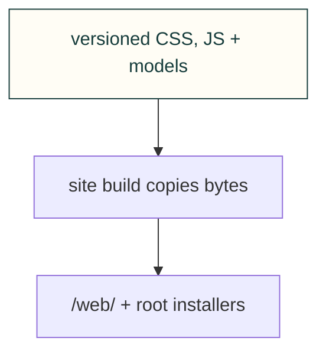

# Website assets

These files keep their public /web/ addresses. The build also copies favicon.ico, install.sh and install.ps1 to their existing root URLs; this owning README is source-only.

[Site tooling](../README.md) · [Tests](../../../tests/site/README.md)
