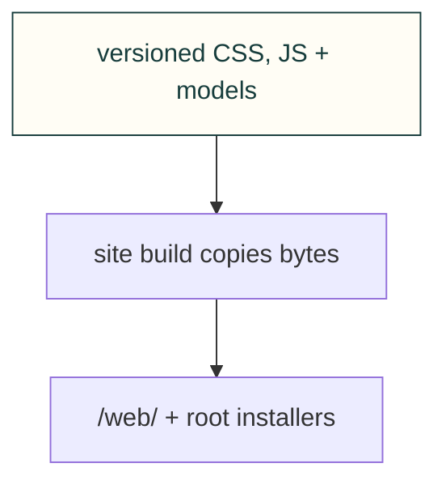

# Website assets

These files keep their public /web/ addresses. The build also copies favicon.ico, install.sh and install.ps1 to their existing root URLs; this owning README is source-only.

The application theme is owned by the [shared browser UI](../../../software/cadagent/webkit/ui/README.md); the site loads its `/kit/ui/theme.css` and `/kit/ui/theme.js` directly.

[Site tooling](../README.md) · [Tests](../../../tests/site/README.md)

## File and child ownership

| File or folder | Purpose |
|---|---|
| [discovery.js](discovery.js) | Enhance catalogue detail disclosures from the revision-bound existing feed. |
| [discovery.css](discovery.css) | Compact shared Explore search and topic layout. |
| [catalog.css](catalog.css) | Catalogue layout and reading styles. |
| [favicon.ico](favicon.ico) | Browser icon. |
| [home.css](home.css) | Learning narrative and independently loaded project showcase layout. |
| [icon.svg](icon.svg) | Original project emblem. |
| [install.ps1](install.ps1) | PowerShell installer snapshot source. |
| [install.sh](install.sh) | POSIX installer snapshot source. |
| [references.css](references.css) | Reference browsing styles. |
| [references.js](references.js) | Reference search/filter interaction. |
| [site.css](site.css) | Shared site layout and typography. |
| [site.js](site.js) | Shared site navigation and interaction. |
| [toolkit.css](toolkit.css), [toolkit.js](toolkit.js) | Scoped Toolkit browsing, filters and lazy interactive SCADA state previews. |
| [models/](models/README.md) | Coherent homepage model/poster bundle. |

## Screen layouts

Wide page shells use the available display with responsive gutters. Reading widths
belong to narrative paragraphs and lists; they must not cap an entire diagram,
table, gallery or application. Collection grids add useful columns rather than
stretching a few cards across an ultrawide monitor. Homepage art keeps its aspect
ratio and a bounded height beside the introduction.

An application owns its available viewport and passes that space to its viewers.
Camera surfaces use pan/zoom and a visible Fit control, with native canvas
scrolling disabled; documents and inspectors can scroll normally. Review the
actual 3440×1440 layout as well as ordinary desktop and mobile sizes. The
[site browser checks](../../../tests/site/README.md) cover the built pages rather
than treating the absence of overflow as evidence that the screen is used well.
