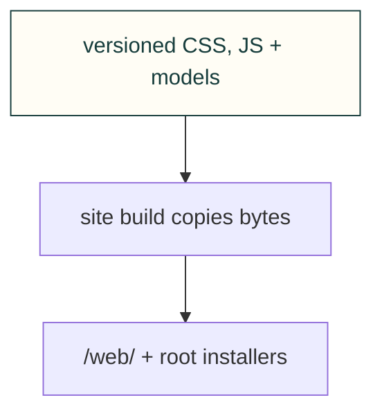

# Website assets

These files keep their public /web/ addresses. The build also copies favicon.ico, install.sh and install.ps1 to their existing root URLs; this owning README is source-only.

[Site tooling](../README.md) · [Tests](../../../tests/site/README.md)

## File and child ownership

| File or folder | Purpose |
|---|---|
| [discovery.js](discovery.js) | Enhance catalogue detail disclosures from the revision-bound existing feed. |
| [discovery.css](discovery.css) | Compact shared Explore search and topic layout. |
| [catalog.css](catalog.css) | Catalogue layout and reading styles. |
| [favicon.ico](favicon.ico) | Browser icon. |
| [icon.svg](icon.svg) | Original project emblem. |
| [install.ps1](install.ps1) | PowerShell installer snapshot source. |
| [install.sh](install.sh) | POSIX installer snapshot source. |
| [references.css](references.css) | Reference browsing styles. |
| [references.js](references.js) | Reference search/filter interaction. |
| [site.css](site.css) | Shared site layout and typography. |
| [site.js](site.js) | Shared site navigation and interaction. |
| [theme.js](theme.js) | Theme preference/bootstrap behavior. |
| [models/](models/README.md) | Coherent homepage model/poster bundle. |
