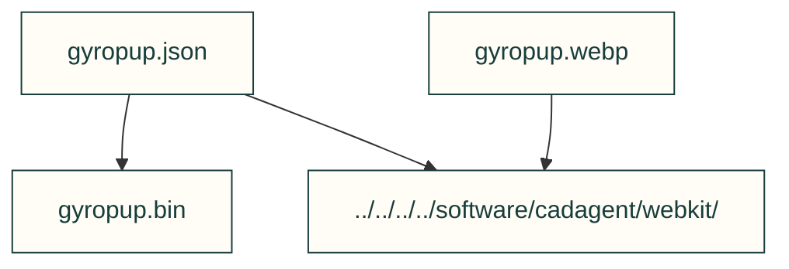

# Homepage model bundle

The homepage viewer uses this packed model and its matching poster. The model
metadata records the CAD source revision and input hashes. The source record
links the banner to those same model and poster bytes.

| File or folder | Purpose |
|---|---|
| [gyropup.json](gyropup.json) | Model structure, part groups, units and binary metadata. |
| [gyropup.bin](gyropup.bin) | Packed mesh buffers for the exact JSON model. |
| [j501.json](j501.json) | Packed existing J501 assembly, including the real carrier-board mesh; lid initially hidden. |
| [j501.bin](j501.bin) | Render-only display mesh, 0.4 mm vertex-cell clustering, not manufacturing geometry. |
| [j501-source.json](j501-source.json) | Input hashes, reference attribution, coordinate proof, collection-context limits and display displacement records. |
| [j501.webp](j501.webp) | Matching shared-viewer poster at the recorded opening view; hashes and renderer recorded in j501-source.json. |
| [gyropup.webp](gyropup.webp) | Matching model poster for deferred/no-JavaScript viewing. |

[Parent map](https://github.com/Valpatel/cad-agent/blob/dev/tools/site/assets/README.md)

The collected Gyropup CAD shows one work-in-progress battery envelope at the
front and one at the rear. Physical fit, insertion and removal clearance,
retention, and load qualification remain open.

[Current model and historical illustration source record](https://github.com/Valpatel/cad-agent/blob/dev/docs/img/gyropup/SOURCE.json)

Homepage #605 adds a second independent shared viewer for the J501 enclosure and
its real carrier-board CAD. Collection will reuse existing assembly-coordinate
meshes from the clean product checkout, with selected-file hashes and exact source
revision recorded beside the packed model. Packing is not a CAD rebuild or a
physical fit qualification. Keep the current Gyropup model/source bytes intact.
