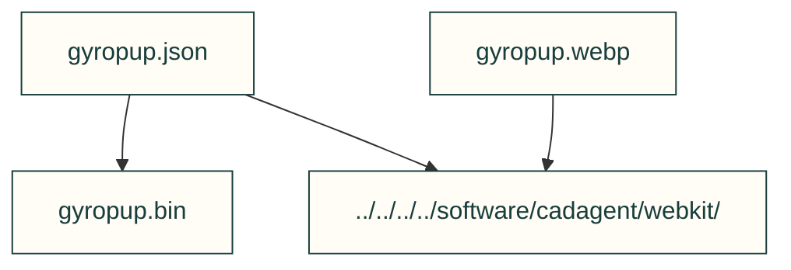

# Homepage model bundle

Packed model and matching poster consumed by the homepage viewer. Source collection and provenance remain in docs/img/gyropup/SOURCE.json.

| File or folder | Purpose |
|---|---|
| [gyropup.json](gyropup.json) | Model structure, part groups, units and binary metadata. |
| [gyropup.bin](gyropup.bin) | Packed mesh buffers for the exact JSON model. |
| [gyropup.webp](gyropup.webp) | Matching model poster for deferred/no-JavaScript viewing. |

[Parent map](../README.md)

[Recorded producer](../../../../docs/img/gyropup/SOURCE.json). The current battery placement remains underbody; no relocation or physical-motion claim.
