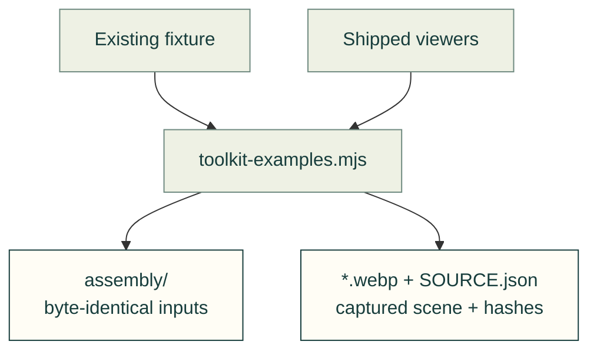
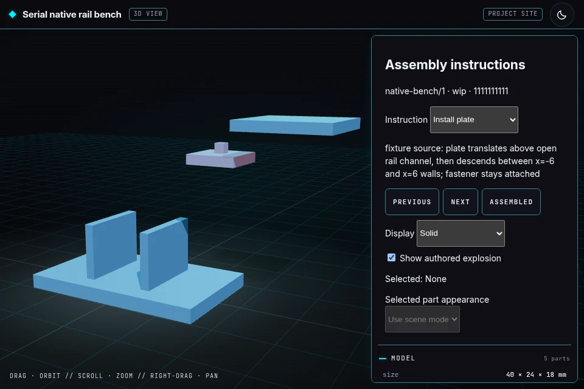

# Toolkit examples

Small source-bound examples and actual browser previews for the Toolkit capability cards.

The generator copies the existing assembly fixture unchanged; both previews come from the shipped viewers.



| File or folder | Purpose |
|---|---|
| [assembly/](assembly/README.md) | Eight-file synthetic assembly example, closed over its JSON and mesh dependencies. |
| [assembly.webp](assembly.webp) | Actual assembly viewer, first instruction with solid parts and authored separation. |
| [file-review.webp](file-review.webp) | Actual original STL viewer, showing the existing host example block in isometric view. |
| [SOURCE.json](SOURCE.json) | Exact fixture, generator, runtime and preview hashes; browser version, route and controlled scene state. |



The site copies these bytes to `/web/toolkit/`. Open the [assembly example](https://cad-agent.valpatel.com/kit/model/viewer.html?guide=/web/toolkit/assembly/guide.json)
or [original-file example](https://cad-agent.valpatel.com/kit/files/file-viewer.html?file=/kit/host/example.stl).
The assembly's `1111111111111111111111111111111111111111` revision is a deliberate test sentinel, not a project commit.
These examples demonstrate viewer controls, not physical fit, hardware design, or simulation accuracy.

With the existing site Node dependencies and a locally installed browser, reproduce from the repository root:

```sh
node tools/site/figures/toolkit-examples.mjs --executable /usr/bin/chromium
node tools/site/figures/toolkit-examples.mjs --check
```

Use `--chromium` instead of `--executable` for the already installed Playwright Chromium; `PLAYWRIGHT_BROWSERS_PATH`
may select that installation. The generator installs nothing and blocks non-local browser requests. It waits for
loaded meshes, font readiness and stable painted camera frames before capturing. `--check` verifies the copied
bytes and preview provenance without starting a browser. Recapture when the fixture, generator or served runtime changes.

[Website assets](../README.md) · [Generator](../../figures/toolkit-examples.mjs) · [Source fixture](../../../../tests/fixtures/assembly-plan/README.md)
