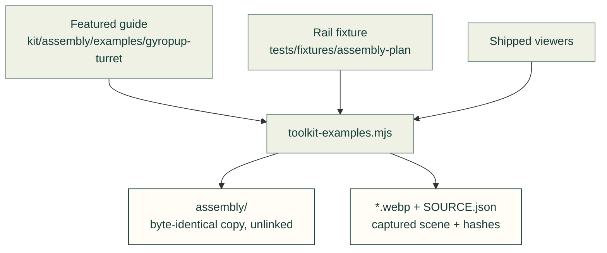
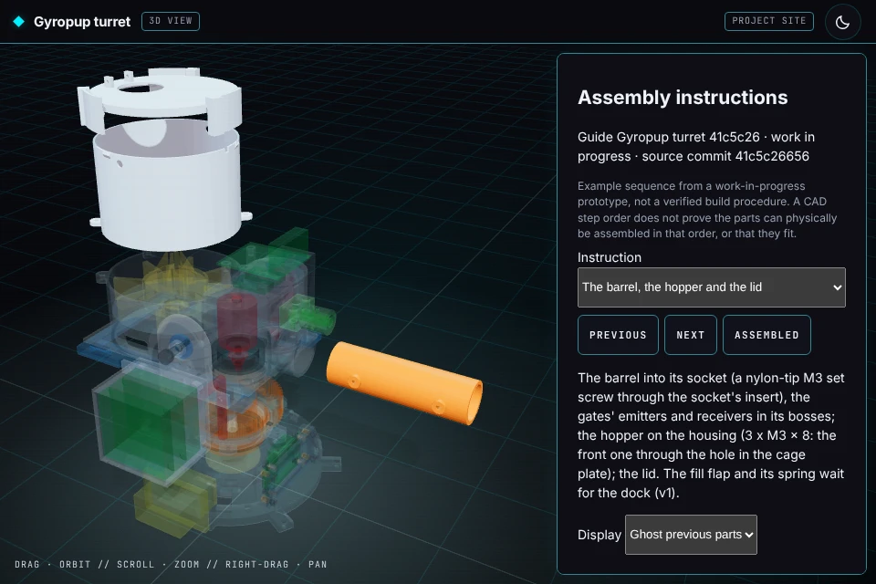

# Toolkit examples

Actual browser previews for two Toolkit capability cards, captured from the shipped viewers.

The build-guide preview shows the featured example, Gyropup's turret guide, which lives with the reader in the kit.



| File | Purpose |
|---|---|
| [assembly/](assembly/README.md) | The synthetic rail fixture, copied byte for byte and kept at its published URL; unlinked, not featured. |
| [assembly.webp](assembly.webp) | Actual assembly reader on step 11 of Gyropup's turret guide: the barrel, hopper and lid arrive over the ghosted turret. |
| [file-review.webp](file-review.webp) | Actual original STL viewer, showing the existing host example block in isometric view. |
| [SOURCE.json](SOURCE.json) | The featured guide's revision and hashes, generator and runtime hashes, preview hashes; browser version, route and controlled scene state. |



The site copies these bytes to `/web/toolkit/`. Open the [build guide](https://cad-agent.valpatel.com/kit/model/viewer.html?guide=/kit/assembly/examples/gyropup-turret/guide.json)
or the [original-file example](https://cad-agent.valpatel.com/kit/files/file-viewer.html?file=/kit/host/example.stl).
The guide is an example sequence from a work-in-progress prototype, not a verified build procedure; a CAD step order
does not prove the parts can physically be assembled in that order. These previews demonstrate viewer controls, not
physical fit, hardware design, or simulation accuracy.

With the existing site Node dependencies and a locally installed browser, reproduce from the repository root:

```sh
node tools/site/figures/toolkit-examples.mjs --executable /usr/bin/chromium
node tools/site/figures/toolkit-examples.mjs --check
```

Use `--chromium` instead of `--executable` for the already installed Playwright Chromium; `PLAYWRIGHT_BROWSERS_PATH`
may select that installation. The generator installs nothing and blocks non-local browser requests. It waits for
loaded meshes, font readiness and stable painted camera frames before capturing. `--check` verifies the featured
guide's closure and the preview provenance without starting a browser. Recapture when the guide, the generator or the
served runtime changes; regenerate the guide itself with its [converter](../../../../docs/examples/build-guide/README.md).

[Website assets](../README.md) · [Generator](../../figures/toolkit-examples.mjs) · [Featured guide](../../../../software/cadagent/webkit/assembly/examples/gyropup-turret/README.md)
