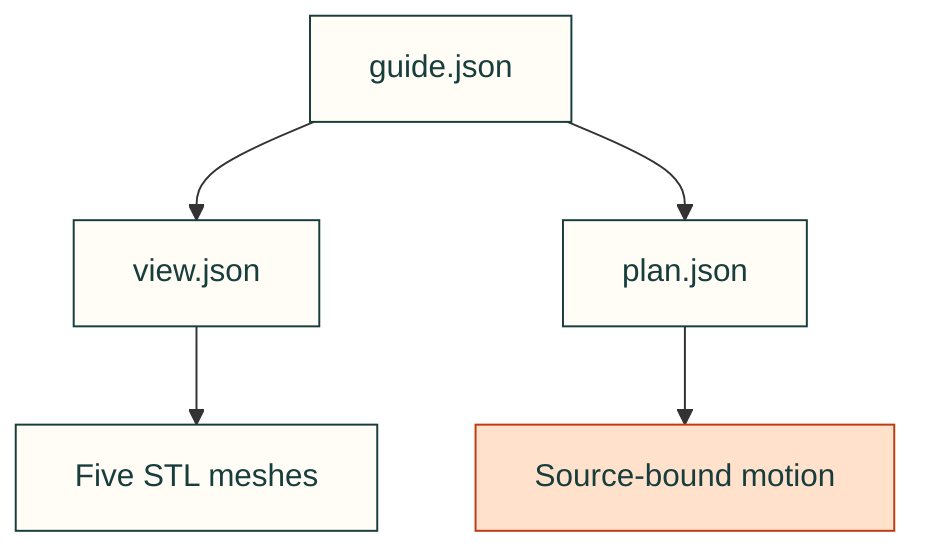
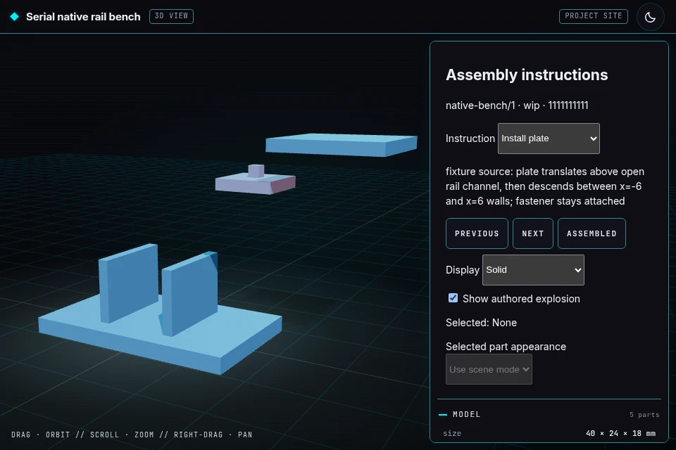

# Synthetic assembly guide

The existing five-part clearance fixture, copied unchanged for the website's working build-guide example.

The guide binds its model and serial plan by SHA-256; the model binds every mesh. No additional assets are fetched.

| File | Purpose |
|---|---|
| [guide.json](guide.json) | Two assembly instructions with exact model and plan bindings. |
| [view.json](view.json) | Millimeter, Z-up model manifest with five mesh hashes. |
| [plan.json](plan.json) | Source-defined serial plate and lid movements; geometry and tooling bindings remain intact. |
| [base.stl](base.stl) | Fixture base. |
| [rail.stl](rail.stl) | Compound rail with an open insertion channel. |
| [plate.stl](plate.stl) | Plate moved into the channel. |
| [fastener.stl](fastener.stl) | Attached test-fastener prism; no threaded engagement claim. |
| [lid.stl](lid.stl) | Lid installed after the plate. |

Open [the existing guide viewer](https://cad-agent.valpatel.com/kit/model/viewer.html?guide=/web/toolkit/assembly/guide.json)
to change instructions, compare assembled and separated parts, orbit, zoom, or change the selected part's appearance.
The fixture's sentinel revision `1111111111111111111111111111111111111111` deliberately identifies synthetic inputs.
Support, retention, threaded engagement and rigid-module qualification are unverified. No acceptance or historical
test receipts are published as project evidence.

Regenerate through the [parent command](../README.md), never by editing these eight copies.
[SOURCE.json](../SOURCE.json) records each original path and exact byte hash. The originals and their native generator
remain in the [test fixture owner](../../../../../tests/fixtures/assembly-plan/README.md).

[Toolkit examples](../README.md) · [Assembly runtime](../../../../../software/cadagent/webkit/assembly/README.md)
