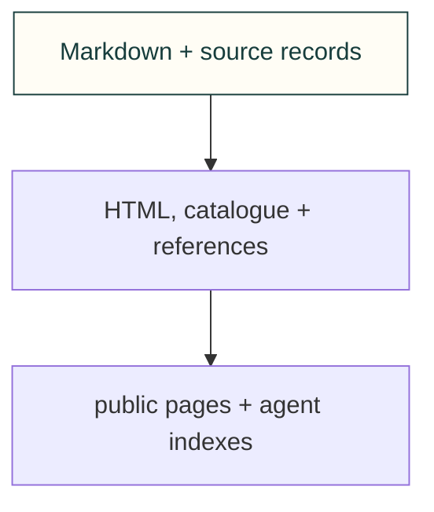

# Site compilers

Compile selected committed sources. Physical paths supply provenance; emitted URLs remain public identities.

[Site tooling](../README.md) · [Tests](../../../tests/site/README.md)

## File and child ownership

| File or folder | Purpose |
|---|---|
| [catalog-art.mjs](catalog-art.mjs) | Select catalogue covers and visual summaries. |
| [repo-map.json](repo-map.json) | Explicit exceptional parent-ownership contracts. |
| [site-catalog.mjs](site-catalog.mjs) | Build catalogue/index/agent metadata. |
| [site-explore-shell.mjs](site-explore-shell.mjs) | Shared topic placement, reading navigation and Pacific timestamp formatting. |
| [site-discovery.mjs](site-discovery.mjs) | Derive shared search links while retaining catalogue/reference identities. |
| [site-diagrams.mjs](site-diagrams.mjs) | Draw shared light/dark Mermaid figures. |
| [site-html.mjs](site-html.mjs) | Sanitize HTML, rewrite destinations and size images. |
| [site-pages.mjs](site-pages.mjs) | Place source-bound page figures/cards/folds. |
| [site-redirects.txt](site-redirects.txt) | Retained public route redirects. |
| [site-references.mjs](site-references.mjs) | Compile reference records and public pages. |
| [site-repo-map.mjs](site-repo-map.mjs) | Validate folder ownership and generate docs/map.md. |
| [snap-demo.mjs](snap-demo.mjs) | Capture existing demo pictures. |
