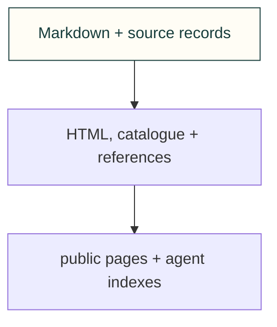

# Site compilers

Compile selected committed sources. Physical paths supply provenance; emitted URLs remain public identities.

[Site tooling](../README.md) · [Tests](../../../tests/site/README.md)
