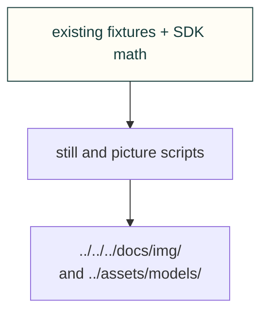

# Site figures

Draw explorer stills and capture existing viewers. A computed picture is evidence of the stated software inputs, not physical qualification.

[Site tooling](../README.md) · [Tests](../../../tests/site/README.md)

## File and child ownership

| File or folder | Purpose |
|---|---|
| [cantilever-still.mjs](cantilever-still.mjs) | Snapshot the cantilever example. |
| [fan-curve-still.mjs](fan-curve-still.mjs) | Snapshot fan curve data. |
| [fourbar-still.mjs](fourbar-still.mjs) | Snapshot the four-bar example. |
| [printed-boss-still.mjs](printed-boss-still.mjs) | Snapshot printed boss geometry. |
| [site-bench-pictures.mjs](site-bench-pictures.mjs) | Draw benchmark pictures. |
| [site-explore-pictures.mjs](site-explore-pictures.mjs) | Capture exploration examples. |
| [site-kit-pictures.mjs](site-kit-pictures.mjs) | Capture web-kit examples. |
| [site-model-poster.mjs](site-model-poster.mjs) | Draw matching model poster/card. |
| [site-packet-pictures.py](site-packet-pictures.py) | Render delivery packet pictures. |
| [torsion-snap-still.mjs](torsion-snap-still.mjs) | Snapshot the torsion snap example. |
