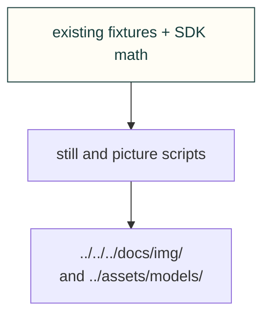

# Site figures

Draw explorer stills and capture existing viewers. A computed picture is evidence of the stated software inputs, not physical qualification.

[Site tooling](../README.md) · [Tests](../../../tests/site/README.md)
