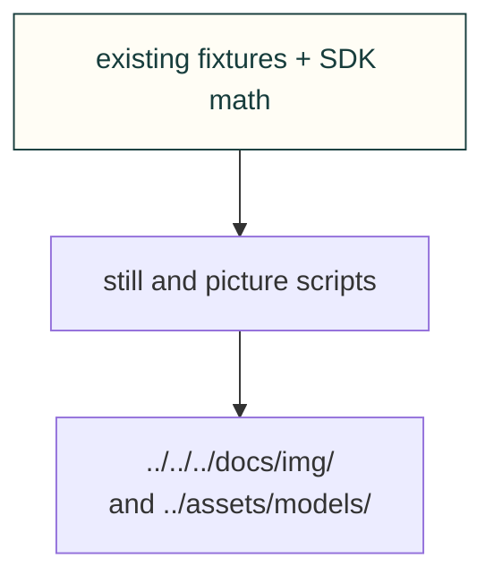

# Site figures

Draw explorer stills and capture existing viewers. A computed picture is evidence of the stated software inputs, not physical qualification.

[Site tooling](../README.md) · [Tests](../../../tests/site/README.md)

## File and child ownership

| File or folder | Purpose |
|---|---|
| [cantilever-still.mjs](cantilever-still.mjs) | Snapshot the cantilever example. |
| [collect-showcase.py](collect-showcase.py) | Bounded no-install, source-pinned candidate collection using the existing product collector and retained CAD runtime; no adoption or publication. |
| [workshop_scene.py](workshop_scene.py) | Original projected sci-fi workshop story: human insight, machine construction, test/revision and shared learning. |
| [learning-home.py](learning-home.py) | Draw original conceptual homepage art and source-bound recorded thermal/airflow animations, without a solver. |
| [pack-j501.py](pack-j501.py) | Hash and pack existing assembly meshes with explicit render-only simplification and a real-board coordinate check. |
| [fan-curve-still.mjs](fan-curve-still.mjs) | Snapshot fan curve data. |
| [fourbar-still.mjs](fourbar-still.mjs) | Snapshot the four-bar example. |
| [printed-boss-still.mjs](printed-boss-still.mjs) | Snapshot printed boss geometry. |
| [site-bench-pictures.mjs](site-bench-pictures.mjs) | Draw benchmark pictures. |
| [site-explore-pictures.mjs](site-explore-pictures.mjs) | Capture exploration examples. |
| [site-kit-pictures.mjs](site-kit-pictures.mjs) | Capture web-kit examples. |
| [site-model-poster.mjs](site-model-poster.mjs) | Draw matching model poster/card. |
| [site-packet-pictures.py](site-packet-pictures.py) | Render delivery packet pictures. |
| [torsion-snap-still.mjs](torsion-snap-still.mjs) | Snapshot the torsion snap example. |

## Source-bound homepage refresh

Use the existing model collector and matching poster tool; review the source and candidate before adoption.

Collect and verify a source-bound homepage model

`collect-showcase.py --source <exact-cad-agent-commit> --contract-json <reviewed-runtime-contract>` is a maintainer
fleet entry point around the unchanged `tools/gyropup_showcase.py`. Review the complete immutable source/operator
packet before a one-shot submission. The contract names an existing retained interpreter/toolkit and whole-tree
fingerprints; this worker never installs packages or creates a virtualenv. It reads the canonical product collector,
records the executed source, seals complete candidate JSON/bin bytes before decoding, and independently compares
producer/product/toolkit/runtime/hardware identities after owned child groups settle. Native work is capped at 600
seconds, decode at 120 seconds and active work at 1,140 seconds within a 4-CPU/8-GiB/30-minute fleet allocation.

The current packet targets Gyropup's immutable front/rear-pack proposal. Both the former belly model and the proposal
use the same battery names, so matching names alone proves no movement: the candidate must match the independently
accepted end-pack bounds and support membership, retain source/leg provenance, and pass the unchanged 400-KiB model
budget. Unexpected counts or size are findings; do not alter visibility/tessellation to force acceptance.

Candidate generation is not asset adoption. Review actual archived bytes, source bindings, decoded geometry and
all five final guards first. Then generate the matching poster/card through `site-model-poster.mjs` in an isolated
candidate, preserving historical pictures and their SOURCE records. Production must wait for incorporation of the
accepted product CAD source into its protected `main`; a WIP collection is not a latest-published or physically
qualified model. This work does not change printed legs or establish fit, retention, strength or printer readiness.

The current candidate records product commit `3a40891962b0b0a04625e070700f1d130bea3c7b`, collected by producer
`b33efacc628488d10a387d071f607b18f9ae0161` before the documentation-only follow-up. The
[model and complete-fetch review](https://github.com/Valpatel/cad-agent/issues/104#issuecomment-6776922469) and
[single poster/card review](https://github.com/Valpatel/cad-agent/pull/528#issuecomment-6777335339) cover their stated
candidate artifacts. Their source bindings remain those executed revisions, not the later adoption commit.

