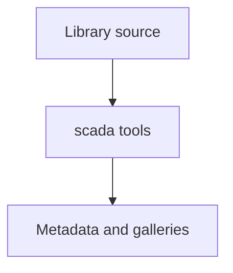

# Browser toolkit development

Development tools for browser runtime libraries; website-only compilation remains in `tools/site/`.

| Owner | Purpose |
| --- | --- |
| [scada/](scada/README.md) | SCADA metadata, gallery, topology and browser verification tools. |

[Parent tools map](../README.md)
