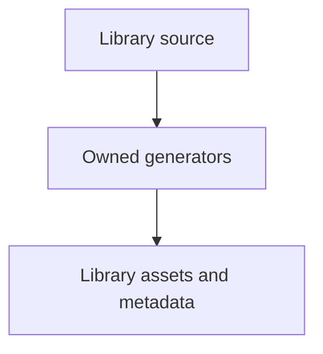

# tools/webkit/scada

SCADA development tooling; runtime sources and generated library assets have separate owners.

| File or folder | Purpose |
| --- | --- |
| [.gitignore](.gitignore) | Keep local browser receipts outside the tracked tooling source. |
| [package-lock.json](package-lock.json) | Reproducible Node dependency resolution. |
| [package.json](package.json) | Owned commands and pinned Node development dependencies. |
| [paths.mjs](paths.mjs) | JavaScript repository, runtime and test owner locations. |
| [scada_paths.py](scada_paths.py) | Python repository, runtime and test owner locations. |
| [sim/](sim/README.md) | Model registries, frozen behavior checks, topology SVGs and scenario maps. |
| [explorer/](explorer/README.md) | Scenario gallery capture and index generation. |
| [ui/](ui/README.md) | System schema, equipment metadata, SVG/JPEG galleries and visual checks. |

[Runtime library map](../../../software/cadagent/webkit/scada/README.md) · [Parent map](../README.md)

From the repository root, run `npm ci --prefix tools/webkit/scada`, then `npm --prefix tools/webkit/scada test`. Generation/check scripts are listed in [package.json](package.json). Capture tools additionally need the pinned [Python requirements](ui/requirements.txt) and Chromium. Runtime imports use neither Node tooling nor browser capture dependencies.

| Changed input | Generate with `npm --prefix tools/webkit/scada run …` | Read-only verification |
| --- | --- | --- |
| Catalog contracts | `build:schema`, `build:metadata` | `check:schema`, `check:metadata` |
| Artwork or styles | `gallery:generate`, `thumbnails` | `gallery:check`, `thumbnails:check`, `qa:gallery` |
| Scenario geometry | `topologies:generate`, `docs:scenarios` | `topologies:check`, `docs:scenarios:check` |
| Explorer, model or scenario capture inputs | `thumbnails:scenarios` | `thumbnails:scenarios:check` |
| Runtime behavior | No generated expectation replacement | `test`, `check:default-baseline`, relevant `qa:*` commands |

Generators write only their declared library-owned outputs. Browser receipts and
diagnostic screenshots belong under ignored `.cache/scada/`, not runtime source.
Do not edit capture hashes or replace the frozen baseline to make a check pass.
Freeze rendering inputs before capturing; a concurrent change correctly makes
the source-bound receipt fail freshness validation. Library Markdown maps may
be refreshed separately only when the owning tool validates existing image
bytes and provenance first.
