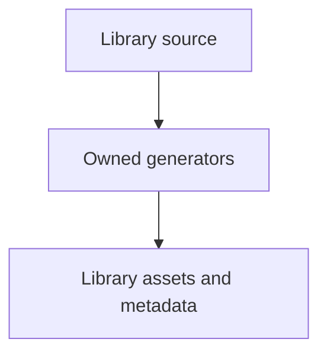
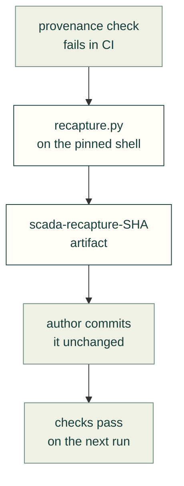

# tools/webkit/scada

SCADA development tooling; runtime sources and generated library assets have separate owners.

| File or folder | Purpose |
| --- | --- |
| [.gitignore](.gitignore) | Keep local browser receipts outside the tracked tooling source. |
| [package-lock.json](package-lock.json) | Reproducible Node dependency resolution. |
| [package.json](package.json) | Owned commands and pinned Node development dependencies. |
| [paths.mjs](paths.mjs) | JavaScript repository, runtime and test owner locations. |
| [gallery_maps.py](gallery_maps.py) | Compact, self-contained SVG ownership maps for generated galleries. |
| [scada_paths.py](scada_paths.py) | Python repository, runtime and test owner locations. |
| [recapture.py](recapture.py) | CI-only: after a failed provenance check, regenerate the stale outputs on the pinned shell and stage exactly the changed files with a hash manifest. |
| [sim/](sim/README.md) | Model registries, frozen behavior checks, topology SVGs and scenario maps. |
| [explorer/](explorer/README.md) | Scenario gallery capture and index generation. |
| [ui/](ui/README.md) | System schema, equipment metadata, SVG/JPEG galleries and visual checks. |

[Runtime library map](../../../software/cadagent/webkit/scada/README.md) · [Parent map](../README.md)

From the repository root, run `npm ci --ignore-scripts --prefix tools/webkit/scada`, then `npm --prefix tools/webkit/scada test`. Generation/check scripts are listed in [package.json](package.json). Capture tools additionally need the pinned [Python requirements](ui/requirements.txt) and Chromium. Runtime imports use neither Node tooling nor browser capture dependencies.

Without the pinned shell, never hand-edit a capture: push the source change and
let CI recapture it. Arrows: what each step hands the next.

Using the recapture artifact

When the `scada (chromium)` provenance step fails, [recapture.py](recapture.py) reruns
the five checks, regenerates only the failing ones and uploads
`scada-recapture-<head SHA>`: exactly the changed outputs plus
`.cache/scada/recapture-manifest.json` (source commit, shell, commands, SHA-256 of
each file). The job still fails. Unpack the artifact at the repository root, delete
any paths the manifest lists under `deleted`, and commit the files unchanged. The
capture is of the pull request merged with its base, so merge the base in first if
it changed SCADA sources. Take the artifact from the run on your pull request's
current head: the artifact name and the manifest's `pull_request_head` carry that SHA.
Commit the artifact whole; never trim it. The first `thumbnails:scenarios`
recapture differs from every committed scenario thumbnail (63 files, about 9 MB; the
differences are in text rendering): it is a one-time re-baseline to the CI shell, after
which recaptures, byte-reproducible on that shell, should change only images whose
pixels change. The script stages nothing outside its generators' outputs, the frozen
baseline included. That guard and the manifest are an integrity aid for our own
branches, not a trust boundary: an artifact from a fork's run proves nothing.

| Changed input | Generate with `npm --prefix tools/webkit/scada run …` | Read-only verification |
| --- | --- | --- |
| Catalog contracts | `build:schema`, `build:metadata` | `check:schema`, `check:metadata` |
| Artwork or styles | `gallery:generate`, `thumbnails` | `gallery:check`, `thumbnails:check`, `qa:gallery` |
| Scenario geometry | `topologies:generate`, `docs:scenarios` | `topologies:check`, `docs:scenarios:check` |
| Explorer, model or scenario capture inputs | `thumbnails:scenarios` | `thumbnails:scenarios:check` |
| Runtime behavior | No generated expectation replacement | `test`, `check:default-baseline`, relevant `qa:*` commands |

Generators write only their declared library-owned outputs. Browser receipts and
diagnostic screenshots belong under ignored `.cache/scada/`, not runtime source.
Do not edit capture hashes or replace the frozen baseline to make a check pass;
without the pinned shell, use the recapture route above.
Freeze rendering inputs before capturing; a concurrent change correctly makes
the source-bound receipt fail freshness validation. Library Markdown maps may
be refreshed separately only when the owning tool validates existing image
bytes and provenance first.
