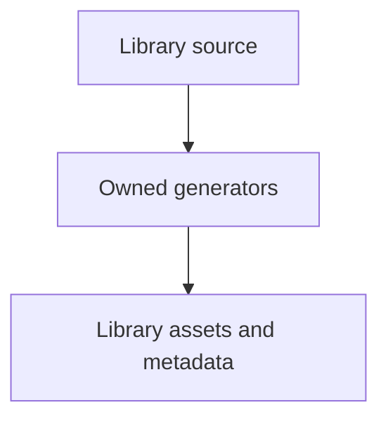

# tools/webkit/scada

SCADA development tooling; runtime sources and generated library assets have separate owners.

| File or folder | Purpose |
| --- | --- |
| [.gitignore](.gitignore) | Keep local browser receipts outside the tracked tooling source. |
| [package-lock.json](package-lock.json) | Reproducible Node dependency resolution. |
| [package.json](package.json) | Owned commands and pinned Node development dependencies. |
| [paths.mjs](paths.mjs) | JavaScript repository, runtime and test owner locations. |
| [gallery_maps.py](gallery_maps.py) | Compact, self-contained SVG ownership maps for generated galleries. |
| [scada_paths.py](scada_paths.py) | Python repository, runtime and test owner locations. |
| [recapture.py](recapture.py) | CI-only: after a failed provenance check, regenerate the stale outputs on the pinned shell and stage exactly the changed files with a hash manifest. |
| [sim/](sim/README.md) | Model registries, frozen behavior checks, topology SVGs and scenario maps. |
| [explorer/](explorer/README.md) | Scenario gallery capture and index generation. |
| [ui/](ui/README.md) | System schema, equipment metadata, SVG/JPEG galleries and visual checks. |

[Runtime library map](../../../software/cadagent/webkit/scada/README.md) · [Parent map](../README.md)

From the repository root, run `npm ci --ignore-scripts --prefix tools/webkit/scada`, then `npm --prefix tools/webkit/scada test`. Generation/check scripts are listed in [package.json](package.json). Capture tools additionally need the pinned [Python requirements](ui/requirements.txt) and Chromium. Runtime imports use neither Node tooling nor browser capture dependencies.

| Changed input | Generate with `npm --prefix tools/webkit/scada run …` | Read-only verification |
| --- | --- | --- |
| Catalog contracts | `build:schema`, `build:metadata` | `check:schema`, `check:metadata` |
| Artwork or styles | `gallery:generate`, `thumbnails` | `gallery:check`, `thumbnails:check`, `qa:gallery` |
| Scenario geometry | `topologies:generate`, `docs:scenarios` | `topologies:check`, `docs:scenarios:check` |
| Explorer, model or scenario capture inputs | `thumbnails:scenarios` | `thumbnails:scenarios:check` |
| Runtime behavior | No generated expectation replacement | `test`, `check:default-baseline`, relevant `qa:*` commands |

Generators write only their declared library-owned outputs. Browser receipts and
diagnostic screenshots belong under ignored `.cache/scada/`, not runtime source.
Do not edit capture hashes or replace the frozen baseline to make a check pass.
Without the pinned shell (a cloud session, or another browser that rewrites every
image), push the source change anyway: when the `scada (chromium)` job's provenance
step fails, it reruns the five checks, regenerates only the failing ones on its own
pinned shell and uploads `scada-recapture-<head SHA>`, which holds exactly the changed
outputs plus `.cache/scada/recapture-manifest.json` (source commit, shell, commands,
SHA-256 of each file). The job still fails. Download that artifact from the failed
run, unpack it at the repository root, delete any paths its manifest lists under
`deleted`, and commit the files unchanged; never hand-edit them. The manifest stays
in ignored `.cache/`. On a pull request the capture is of the merge with the base
branch, so merge the base in first if it changed SCADA sources. The script
([recapture.py](recapture.py)) refuses to stage any file
outside its generators' outputs, the frozen baseline included.
Freeze rendering inputs before capturing; a concurrent change correctly makes
the source-bound receipt fail freshness validation. Library Markdown maps may
be refreshed separately only when the owning tool validates existing image
bytes and provenance first.
