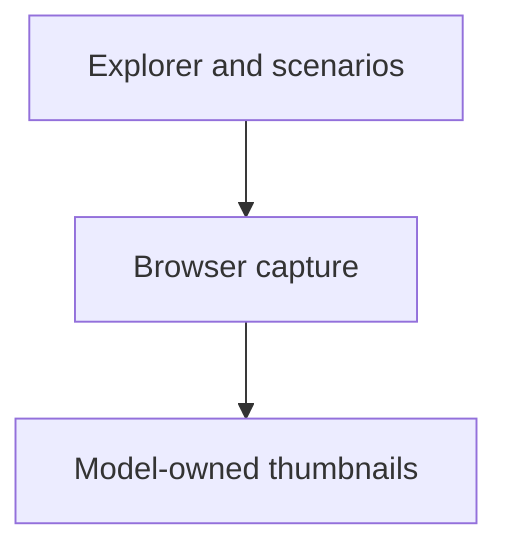

# SCADA scenario captures

Capture the real Explorer and generate the model library’s scenario gallery maps.

| File or folder | Purpose |
| --- | --- |
| [qa/](qa/README.md) | Browser flow, sound and viewport verification. |
| [generate-scenario-thumbnails.py](generate-scenario-thumbnails.py) | Real browser capture, provenance and freshness checks. |
| [scenario_gallery_docs.py](scenario_gallery_docs.py) | Generated gallery indexes from validated capture records. |

From the repository root: `npm --prefix tools/webkit/scada run thumbnails:scenarios`; verify with `npm --prefix tools/webkit/scada run thumbnails:scenarios:check`.

[Parent map](../README.md)

Captures verify the full authored equipment inventory against the fitted presentation. The receipt records both authored world bounds and any opt-in process-chain projection, with actual camera coverage and clipping checks. Shared palette, bootstrap and local font bytes are explicit capture dependencies.
