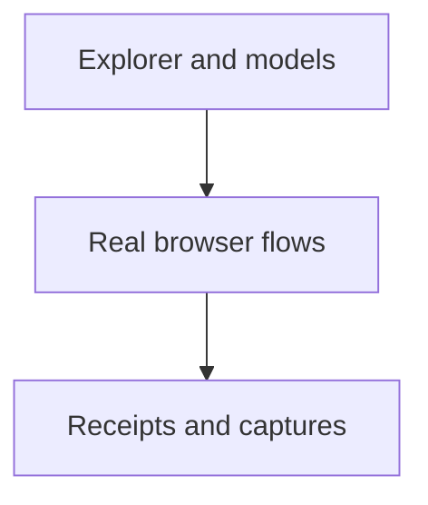

# Explorer browser verification

Inspect the actual Explorer, its state controls, sound and bounded viewport.

| File | Purpose |
| --- | --- |
| [check-scenario-browser.py](check-scenario-browser.py) | Scenario catalog, views, controls and source-bound browser receipts. |
| [check-scenario-audio-browser.py](check-scenario-audio-browser.py) | Web Audio permission, mixing, pause and teardown behavior. |
| [audio_probe.py](audio_probe.py) | Instrument real audio output without replacing the model. |
| [check-explorer-browser-edges.py](check-explorer-browser-edges.py) | Narrow layout, field edits, search, import and error paths. |
| [measure-scada-viewport.py](measure-scada-viewport.py) | Record actual viewport and diagram bounds. |

Use each script’s `--help`; default input is this checkout and receipts go under `.cache/scada/`. These tools require the parent capture dependencies and Chromium.

[Parent map](../README.md)
