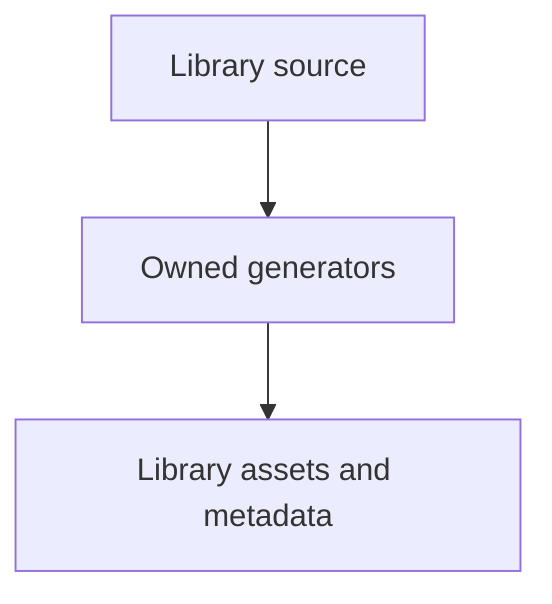

# tools/webkit/scada/sim

SCADA development tooling; runtime sources and generated library assets have separate owners.

| File or folder | Purpose |
| --- | --- |
| [build-metadata.mjs](build-metadata.mjs) | Generate or verify portable registry JSON without browser imports. |
| [check-default-baseline.mjs](check-default-baseline.mjs) | Read-only comparison of 1,440 original model checkpoints. |
| [check-model-switching-browser.py](check-model-switching-browser.py) | Exercise real provider swaps, errors, restore and views in Chromium. |
| [check-topologies-browser.py](check-topologies-browser.py) | Inspect topology images, dimensions, labels and source freshness. |
| [generate-scenario-docs.py](generate-scenario-docs.py) | Generate scenario README maps from actual system/model/catalog data. |
| [generate-topologies.py](generate-topologies.py) | Render compact scenario SVGs with routed equipment identities. |
| [topology/](topology/README.md) | Owned child workflow and file map. |

[Runtime library map](../../../../software/cadagent/webkit/scada/README.md) · [Parent map](../README.md)
