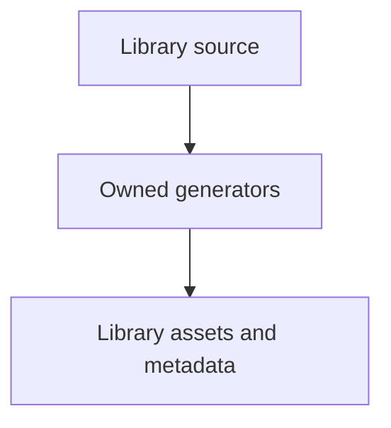

# tools/webkit/scada/sim/topology

SCADA development tooling; runtime sources and generated library assets have separate owners.

| File or folder | Purpose |
| --- | --- |
| [layout.py](layout.py) | Compact topology layout, routing and intersection validation. |
| [symbol-exporter.mjs](symbol-exporter.mjs) | Extract canonical equipment symbols for topology generation. |

[Runtime library map](../../../../../software/cadagent/webkit/scada/README.md) · [Parent map](../README.md)

The scenario catalog may name `topologyView` to choose a focused static schematic;
otherwise the first authored view is used. This never changes the Explorer's initial
view or the captured live JPEG. Missing view IDs reject generation. Wide authored
views receive wider SVGs with the same card typography and routing clearance; all
static schematics retain exact connection identities and reject crossings, shared
line segments and routes through equipment.
