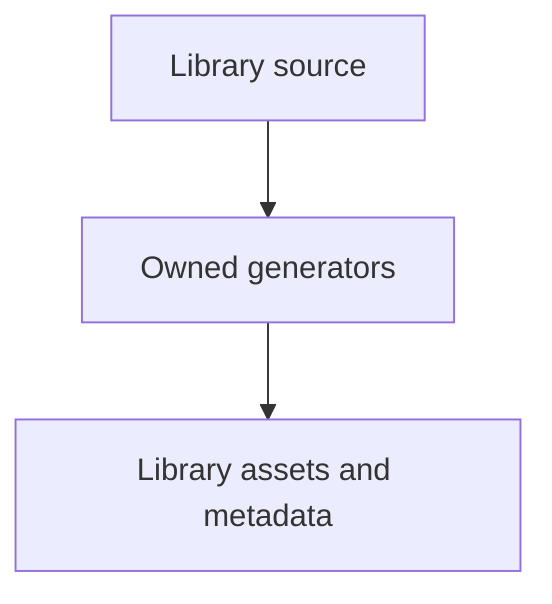

# tools/webkit/scada/ui

SCADA development tooling; runtime sources and generated library assets have separate owners.

| File or folder | Purpose |
| --- | --- |
| [browser_capture.py](browser_capture.py) | Freeze animation frames and verify camera coverage during capture. |
| [build-metadata.mjs](build-metadata.mjs) | Generate or verify portable registry JSON without browser imports. |
| [build-schema.mjs](build-schema.mjs) | Generate or verify the system JSON Schema from component contracts. |
| [gallery/](gallery/README.md) | Owned child workflow and file map. |
| [generate-gallery.py](generate-gallery.py) | Export self-contained animated SVGs from canonical artwork and CSS. |
| [generate-thumbnails.py](generate-thumbnails.py) | Capture component, variant and workspace JPEGs with provenance. |
| [qa/](qa/README.md) | Owned child workflow and file map. |
| [requirements.txt](requirements.txt) | Pinned Python browser/image development dependencies. |

[Runtime library map](../../../../software/cadagent/webkit/scada/README.md) · [Parent map](../README.md)
