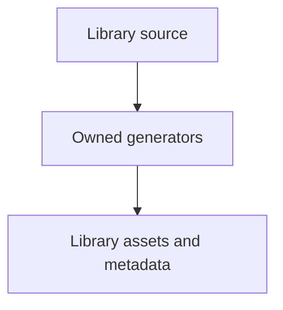

# tools/webkit/scada/ui/gallery

SCADA development tooling; runtime sources and generated library assets have separate owners.

| File or folder | Purpose |
| --- | --- |
| [asset_maps.py](asset_maps.py) | Generate bounded category/type folder maps with relative image previews. |
| [css-source-tree.mjs](css-source-tree.mjs) | Retain original CSS rule slices and enforce local dependency closure. |
| [exporter.mjs](exporter.mjs) | Browser SVG exporter using the production equipment renderer. |
| [inventory.mjs](inventory.mjs) | Pure expected catalog/state gallery inventory. |
| [samples.json](samples.json) | Explicit visual-state samples and expected animation behavior. |

[Runtime library map](../../../../../software/cadagent/webkit/scada/README.md) · [Parent map](../README.md)
