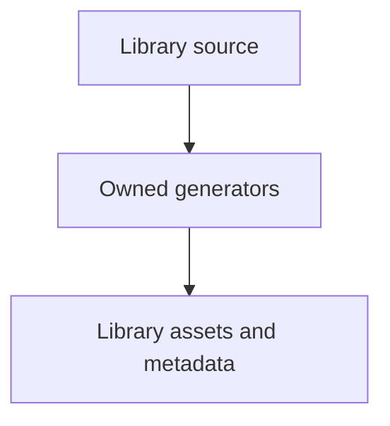

# tools/webkit/scada/ui/qa

SCADA development tooling; runtime sources and generated library assets have separate owners.

| File or folder | Purpose |
| --- | --- |
| [check-component-kit.py](check-component-kit.py) | Browser-test an explicit extracted or archived standalone UI kit. |
| [check-component-states.py](check-component-states.py) | Inspect runtime component state artwork and animation semantics. |
| [check-fault-semantics.py](check-fault-semantics.py) | Verify equipment fault observations and matching rendered effects. |
| [check-gallery.py](check-gallery.py) | Compare SVG image exports with full styles and inspect motion. |
| [check-scada-viewer-browser.py](check-scada-viewer-browser.py) | Exercise reusable viewer controls, read-only behavior and teardown. |

[Runtime library map](../../../../../software/cadagent/webkit/scada/README.md) · [Parent map](../README.md)
