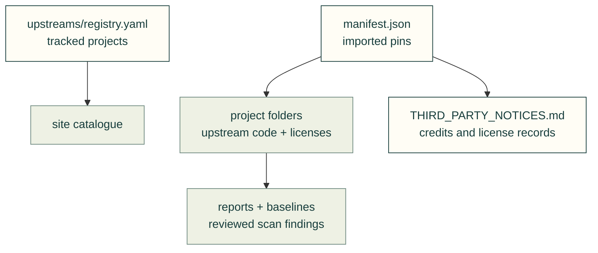

# Upstream code and metadata

Imported code keeps its upstream layout and license. The registry records projects we track; a registry entry does not mean its code was imported or validated.

| File or folder | Purpose |
|---|---|
| [upstreams/](upstreams/README.md) | Tracked-project registry; catalogue data and adoption assessment |
| [manifest.json](manifest.json) | Imported projects, exact source commits and license records |
| [THIRD_PARTY_NOTICES.md](THIRD_PARTY_NOTICES.md) | Vendored, runtime and web-kit credits; the sync tool updates only its vendored-project table |
| `baselines/`, `reports/`, `patches/` | Reviewed scan fingerprints, import reports and local patches |
| Project folders | Imported upstream code; each remains pinned in the manifest |

Use [vendor_sync.py](../tools/vendor_sync.py) for imports and notice updates, and the [supply-chain skill](../skills/cad-supply-chain/SKILL.md) for checks. Repository metadata paths are explicitly classified; unexpected files under them still trigger the vendor audit.
