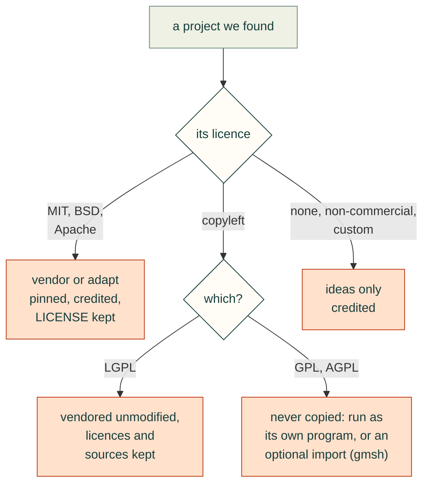

# Third-party notices

Code under `vendor/` is copied from the projects below at the pinned commit. Each directory keeps its
upstream LICENSE/NOTICE files; those terms apply to that code. Our changes are listed as patches in `vendor/patches/`.

| Project | Licence | Upstream | Pinned commit | Imported |
|---|---|---|---|---|
| text-to-cad | MIT | https://github.com/earthtojake/text-to-cad | `2f793659fb7b` | 2026-10-24 |
| kicad-happy | MIT | https://github.com/aklofas/kicad-happy | `2fd9aa0fe2d6` | 2026-10-24 |
| kicad-mcp-pro | MIT | https://github.com/oaslananka/kicad-mcp-pro | `f03b478f597d` | 2026-10-24 |
| build123d-mcp | Apache-2.0 | https://github.com/pzfreo/build123d-mcp | `59b256121886` | 2026-10-24 |
| agentcad | Apache-2.0 | https://github.com/jdilla1277/agentcad | `52af472ddade` | 2026-10-24 |
| bd_warehouse | Apache-2.0 | https://github.com/gumyr/bd_warehouse | `e6ae6e7bae74` | 2026-10-24 |

## Showcase on the site (Gyropup)

The home page shows [Gyropup](https://gyropup.com), a robot designed with cad-agent. Its model and pictures are
copies of Gyropup's CAD exports and results, under its MIT licence ("Copyright (c) 2026 mvalancy and Gyropup
contributors"), whose full text travels with them in `docs/img/gyropup/LICENSE.txt`.
`tools/gyropup_showcase.py` regenerates them and records the revision in each file's source record.

| Files | From | Revision |
|---|---|---|
| `web/models/gyropup.json`, `.bin`, `.webp` (the 3D model and its poster) | Gyropup's whole-robot view (`exports/robot/*.step`: P3 body, five-bar legs, turret) in [Valpatel/gyropup](https://github.com/Valpatel/gyropup), exported with `cad-agent view` | `b79896a` |
| `docs/img/gyropup/wheel-link-fea.webp`, `leg-render.webp` | Gyropup's `exports/leg/fea/wheel_link-E1.png` and `exports/leg/leg-stand-iso.png`, cropped | `77f6d00` |
| `docs/img/gyropup.jpg` | the model's poster on a card, by `tools/site-model-poster.mjs` (`banner` in `docs/img/gyropup/SOURCE.json`) | `b79896a` |

## Runtime dependencies and external programs (not vendored)

The simulation modules and the site build use these at run time. None of their code is copied into this repository.

| Project | Licence | How cad-agent uses it |
|---|---|---|
| OpenFOAM v2512 (OpenCFD) | GPL-3.0 | External program (`cadagent.simulation.cfd` writes a case and runs it natively or in the `opencfd/openfoam-default` Docker image) |
| Bambu Studio | AGPL-3.0 | External program (`cadagent.manufacturing.slicer` runs its command line; profiles are read, flattened and passed back as files) |
| PrusaSlicer | AGPL-3.0 | External program (`cadagent.manufacturing.slicer_prusa` runs its command line: PrusaSlicer resolves the named presets, and they go back to it with the overrides as one config file) |
| gmsh | GPL-2.0-or-later | Imported by the optional `fea` extra. Our source stays MIT; distributing a bundle that includes gmsh falls under the GPL |
| scikit-fem | BSD-3-Clause | Imported (`fea`) |
| pyMOTO | MIT | Imported (`sim`, topology optimisation) |
| PyVista, VTK | MIT, BSD-3-Clause | Imported (`sim`, pictures and animations) |
| trimesh, manifold3d, Rtree | MIT, Apache-2.0, MIT | Imported (`sim`, mesh booleans and point-in-solid tests) |
| Playwright, Chromium | Apache-2.0, BSD-3-Clause | The site build draws its Mermaid diagrams in headless Chromium through Playwright, a dev dependency (`tools/site-diagrams.mjs`); the browser tests run in it too |
| imageio, imageio-ffmpeg (FFmpeg) | BSD-2-Clause (FFmpeg LGPL/GPL binary, run as a process) | Imported (`sim`, MP4 writing) |

## Web kit (copied into project sites and published on cad-agent.valpatel.com)

`src/cadagent/webkit/vendor/` holds these files unchanged unless noted; each keeps its licence text beside it, and
`cad-agent site` copies the licence files with the code.

| Project | Licence | Version | Licence file in the kit |
|---|---|---|---|
| three.js (core and the controls, geometry, loader and utility add-ons) | MIT | r160 (npm 0.160.0); OrbitControls carries one local patch to its wheel step, recorded in `three/SOURCE.json` | header of `three/three.module.min.js`; `file-parsers/THREE-LICENSE.txt` |
| three.js STL and 3MF loaders | MIT | r160, import paths changed to the local copies | `file-parsers/THREE-LICENSE.txt` |
| fflate (the ZIP reader the 3MF loader imports) | MIT | 0.8.3, from npm | `file-parsers/FFLATE-LICENSE.txt` |
| Mermaid | MIT | 11.17.2 | `mermaid/LICENSE` |
| linkedom | ISC | 0.18.12 | `linkedom/LICENSE` |
| occt-import-js (Open CASCADE Technology compiled to WebAssembly) | LGPL-2.1 with the OCCT exception | 0.0.23 | `occt-import-js/` (four licence files; sources in `occt-import-js/source`) |
| Inter | SIL Open Font License 1.1 | 4.001, variable, Latin subset from Google Fonts (sources in `fonts/SOURCE.json`) | `fonts/OFL-Inter.txt` |
| JetBrains Mono | SIL Open Font License 1.1 | 2.211, variable, Latin subset from Google Fonts (sources in `fonts/SOURCE.json`) | `fonts/OFL-JetBrainsMono.txt` |

## Methods, foundations and acknowledgements

The people and projects whose work this stands on. If we use or learned from your work and you are missing or
described wrongly here, please [tell us](https://github.com/Valpatel/cad-agent/issues/new?template=feedback.yml).

**Methods and data we condensed (cited, never redistributed):**
- Covestro (formerly Bayer MaterialScience), *Snap-Fit Joints for Plastics – A Design Guide*: the cantilever,
  torsion and annular snap-fit method.
- DuPont, *General Design Principles – Module I*: permissible strains (Table 10.06).
- Bambu Lab and Polymaker technical data sheets: printed-filament properties by print direction.

**Code we vendor, pinned and security-reviewed** ([`vendor/`](./), [`SECURITY.md`](../.github/SECURITY.md)):
[text-to-cad](https://github.com/earthtojake/text-to-cad) by Thompson Labs LLC (MIT),
[kicad-happy](https://github.com/aklofas/kicad-happy) by Andrew Klofas (MIT),
[kicad-mcp-pro](https://github.com/oaslananka/kicad-mcp-pro) by Osman Aslan (MIT),
[build123d-mcp](https://github.com/pzfreo/build123d-mcp) by Paul Fremantle (Apache-2.0),
[agentcad](https://github.com/jdilla1277/agentcad) by James Dillard (Apache-2.0) and
[bd_warehouse](https://github.com/gumyr/bd_warehouse) by Roger Maitland (Apache-2.0).

**Libraries and programs we run on:** [CadQuery](https://github.com/CadQuery/cadquery) on
[Open CASCADE](https://occt3d.com/open-cascade-technology/) (shapes from [build123d](https://github.com/gumyr/build123d) work too),
[trimesh](https://github.com/mikedh/trimesh), [manifold3d](https://github.com/elalish/manifold),
[gmsh](https://gmsh.info/), [scikit-fem](https://github.com/kinnala/scikit-fem),
[pyMOTO](https://github.com/aatmdelissen/pyMOTO), [PyVista](https://github.com/pyvista/pyvista) and
[VTK](https://vtk.org/), [OpenFOAM](https://www.openfoam.com/), [MuJoCo](https://github.com/google-deepmind/mujoco),
[Optuna](https://github.com/optuna/optuna), [Bambu Studio](https://github.com/bambulab/BambuStudio); in the browser
[three.js](https://github.com/mrdoob/three.js), [Mermaid](https://github.com/mermaid-js/mermaid),
[occt-import-js](https://github.com/kovacsv/occt-import-js) by Viktor Kovács, [fflate](https://github.com/101arrowz/fflate),
[linkedom](https://github.com/WebReflection/linkedom), and the [Inter](https://rsms.me/inter/) (Rasmus Andersson) and
[JetBrains Mono](https://www.jetbrains.com/lp/mono/) (JetBrains) typefaces, both SIL OFL. Board checks read reports
from [KiCad](https://www.kicad.org/)'s `kicad-cli`. OpenFOAM (GPL) and Bambu Studio (AGPL) run only as separate
programs, as does the FFmpeg binary that the `sim` extra's imageio-ffmpeg ships (built with GPL options); gmsh (GPL)
is imported, but only by the optional `fea` extra.

**Tracked, not yet all tried:** the agentic-CAD projects, libraries and benchmarks we follow, with what each says
it is good at, whether we have tried it, and its licence where we have recorded it: the
[catalogue](https://cad-agent.valpatel.com/catalog) and the [landscape survey](../docs/research/agent-workflow/landscape.md). Full licence notices: [`THIRD_PARTY_NOTICES.md`](THIRD_PARTY_NOTICES.md).

