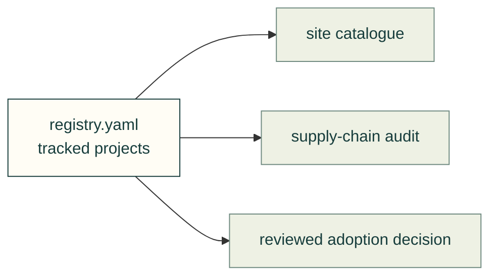

# Tracked upstreams

[registry.yaml](registry.yaml) records projects, their licenses, catalogue descriptions and adoption assessments. It feeds the site catalogue and supply-chain audit; it is separate from the [imported-code manifest](../manifest.json).

| File | Purpose |
|---|---|
| [registry.yaml](registry.yaml) | Source data for tracked projects; keep assessments and evidence limits explicit |

[Vendor map](../README.md) · [Weekly update procedure](../../docs/practice/weekly-upstream-update.md) · [Research entry](../../docs/research/README.md)
